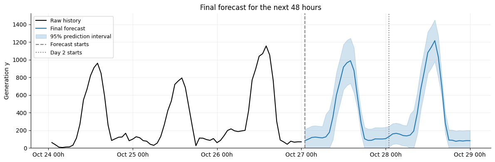

# Forecasting electricity generation for the next 48 hours

**MATH840 time series final project · Kyiv School of Economics**

This project forecasts hourly electricity generation (`y`) for **2026-10-27 01:00 through 2026-10-29 00:00** and provides a 95% prediction interval for each hour. The assignment does not specify a physical unit for `y`. Its ranking emphasizes **hours 25–48**: 30% RMSE rank, 30% MAPE rank, and 40% Winkler score rank.



The current forecast is a **60% Timestral + 30% seasonal naïve + 10% LightGBM** blend. The weights were chosen on rolling cross-validation for the assignment's second-day objective, with each model required to have at least 10% weight. The forecast file is [`output/BARANIUK_project.csv`](output/BARANIUK_project.csv).

## Data

| File | Contents |
| --- | --- |
| [`data/train.csv`](data/train.csv) | 33,480 hourly observations from 2023-01-01 01:00 to 2026-10-27 00:00: timestamp (`ds`), generation (`y`), and observed weather. |
| [`data/weather_forecast.csv`](data/weather_forecast.csv) | Weather forecasts for the next 48 hours, without `y`. |

The seven weather columns describe cloud cover, temperature, wind speed, pressure, humidity, daylight, and air density. Historical evaluation uses *observed* weather in each forecast window; those weather-based scores can be optimistic compared with using actual weather forecasts.

## Model selection and results

The main experiment is [`notebooks/timestral_baseline.ipynb`](notebooks/timestral_baseline.ipynb). At each forecast origin, a model sees only earlier generation and predicts the next 48 hours. It compares pretrained Timestral, LightGBM trained on `log(y)` with generation lags, calendar and weather features, and a seasonal naïve model that repeats the previous day. Timestral reads 180 days of history without fitting; LightGBM is refitted on the previous 180 days at each origin.

The notebook uses **seven earlier windows to calibrate intervals**, **seven subsequent windows to select weather inputs and blend weights**, and **seven windows in the last 14 days for a retrospective holdout**. Each window spans 48 hours, and origins are two days apart. Prediction intervals use the 95th percentile of absolute calibration errors, separately for forecast day and day/night. Error widths are scaled by the recent seven-day generation level. Interval widths for selection are calibrated before the selection windows; the selected recipe is then frozen before the holdout section.

For selection, the notebook combines second-day RMSE, MAPE and Winkler score at the assignment's 30/30/40 weights. Each metric is divided by the seasonal naïve score because the other students' ranks are unavailable. Lower is better. Removing weather features did not improve Timestral's combined score, so the selected model keeps all seven.

| Candidate, hours 25–48 | Selection RMSE ↓ | Selection MAPE ↓ | Selection Winkler ↓ | Retrospective holdout RMSE ↓ | Holdout interval coverage |
| --- | ---: | ---: | ---: | ---: | ---: |
| Selected 60/30/10 three-model blend | 217.32 | **32.09%** | 1476.91 | **241.92** | 86.31% |
| 75% Timestral + 25% seasonal naïve | **211.16** | 32.71% | **1421.25** | 244.47 | 83.33% |
| Timestral with all weather | 220.45 | 35.19% | 1592.64 | 245.27 | 83.93% |
| LightGBM | 287.88 | 34.30% | 1598.73 | 260.11 | 94.05% |
| Seasonal naïve | 308.86 | 46.03% | 1520.88 | 344.42 | 91.67% |

The **75/25 Timestral–naïve blend had the best overall selection score** (0.792 versus 0.809 for the selected blend). The exported 60/30/10 forecast is the best blend within the notebook's three-model constraint. On the holdout's second day, its MAPE was 227.94% and Winkler score was 1469.84. Very small observed night values make percentage errors large. Its 86.31% second-day interval coverage is below the nominal 95% target.

The holdout dates had already been examined in earlier notebooks, so this is **not an untouched test**. Seven selection windows also leave room for selection noise. Neither the holdout scores nor the nominal interval level guarantee performance on the unseen 48 hours.

## Other experiments

- [`notebooks/forecast.ipynb`](notebooks/forecast.ipynb) compares seasonal naïve, AutoETS and their 50/50 blend on one held-back 48-hour window. The blend reached RMSE **114.2**, compared with **120.4** for naïve and **121.9** for AutoETS. It also writes the earlier [`AutoETS/naïve/three-day candidate`](output/BARANIUK_project_ets_snaive_day3.csv).
- [`notebooks/lightgbm_baseline.ipynb`](notebooks/lightgbm_baseline.ipynb) evaluates LightGBM on rolling windows and tests weather sensitivity.
- [`notebooks/lightgbm_blend.ipynb`](notebooks/lightgbm_blend.ipynb) compares LightGBM features, target scales and blends. Its LightGBM plus 25% seasonal naïve on day 2 was the **previous candidate**. The [previous forecast plot](assets/forecast-candidate.png) and [earlier rolling comparison](assets/rolling-comparison.png) document that stage.

The root-level [`submission.csv`](submission.csv) and [`submission2.csv`](submission2.csv) are intermediate exports. `submission2.csv` contains the selected 60/30/10 forecast and matches the canonical file in `output/`.

## Reproduce the forecast

Install [uv](https://docs.astral.sh/uv/), then run from the repository root:

```bash
uv sync
uv run --with notebook jupyter notebook notebooks/timestral_baseline.ipynb
```

Run the notebook cells in order. The final cell validates all 48 timestamps, finite values and ordered interval bounds, then writes [`output/BARANIUK_project.csv`](output/BARANIUK_project.csv) with columns `ds`, `forecast`, `lower_95`, `upper_95`. The pretrained Timestral weights are downloaded on first use; a GPU runtime is recommended. The notebook also has an [Open in Colab](https://colab.research.google.com/github/tbaraniuk/time-series_energy-consumption/blob/main/notebooks/timestral_baseline.ipynb) link. When using a remote kernel, its output file is written on the remote machine, and the final cell displays the exact CSV for local saving.

## LLM use

An LLM assisted with the project code and explanations. This README was drafted with LLM assistance and checked against the notebook outputs and repository files.
