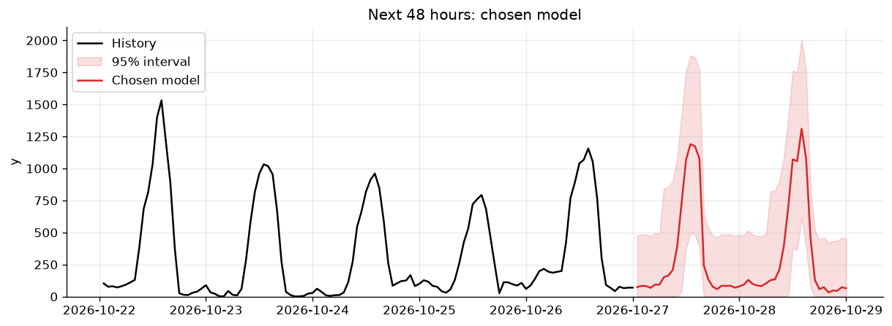
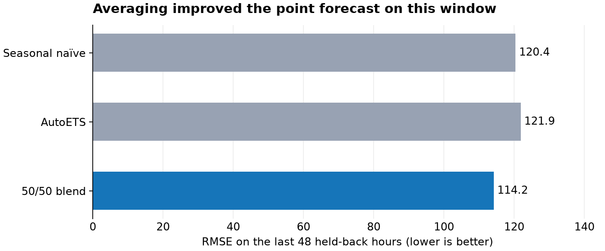

# Forecasting electricity generation for the next 48 hours

**MATH840 time series final project · Kyiv School of Economics**

## The problem

An energy company needs an hourly forecast of its electricity **generation** for the next two days. For each of the 48 hours, we provide a predicted value and a 95% prediction interval. The interval shows the range of plausible outcomes and helps the grid operator plan reserves.

The history ends at **2026-10-27 00:00**. The forecast covers **2026-10-27 01:00 through 2026-10-29 00:00**. The assignment calls the target `y` and does not specify a physical unit for it.



The recent history shows a clear daily pattern: high daytime generation and much lower values at night.

## Data

| File | What it contains |
| --- | --- |
| [`data/train.csv`](data/train.csv) | 33,480 hourly observations from January 2023 to October 2026: time (`ds`), generation (`y`), and observed weather. |
| [`data/weather_forecast.csv`](data/weather_forecast.csv) | Forecast weather for the 48 hours we need to predict. It has no `y` values. |

The weather columns are cloud cover, temperature, wind speed, pressure, humidity, daylight, and air density. The submitted LightGBM model uses all of them, together with past generation and calendar features.

## Our approach

1. **Seasonal naïve baseline:** repeat the generation from the same hour of the previous day.
2. **AutoETS and blends** ([`forecast.ipynb`](notebooks/forecast.ipynb)): fit an exponential smoothing model with a 24-hour season to the recent history and average it with seasonal naïve and the mean of the same hour over the previous three days. Its interval is the seasonal naïve interval scaled to 70%.
3. **LightGBM** ([`lightgbm_baseline.ipynb`](notebooks/lightgbm_baseline.ipynb)): a gradient-boosting model on past-generation profiles, calendar features and the weather forecast, refit on the last 180 days.
4. **Submitted forecast** ([`lightgbm_blend.ipynb`](notebooks/lightgbm_blend.ipynb)): LightGBM trained on `log(y)` with all features for the first 24 hours, and 0.75 · LightGBM + 0.25 · seasonal naïve for hours 25–48. Its 95% interval adds the 95th percentile of absolute cross-validation errors, separately for day and night hours and for each forecast day, and keeps the lower bound at zero or above.

The experimental [LightGBM notebook](notebooks/lightgbm_baseline.ipynb) uses sliding-window cross-validation to compare LightGBM with all seven weather features against the standalone log-scale AutoETS setup from `forecast.ipynb`. It covers exploratory plots of the daily profile and weather relationships, seven CV windows and a 14-day holdout, day/night-calibrated prediction intervals, permutation importance, feature-group ablation, and a weather-noise stress test. Helpers live in `src/final/lgbm_baseline.py`. Historical validation uses observed weather and is therefore optimistic for forecasting.

The [Timestral notebook](notebooks/timestral_baseline.ipynb) runs the same CV and holdout design with Mistral's pretrained `Timestral-209M` model, used zero-shot with the weather as known-future covariates. It compares Timestral with and without weather against AutoETS and seasonal naïve, checks Timestral's native quantile intervals against CV-calibrated ones, and tests covariate groups, context length and noisy weather. Helpers live in `src/final/timestral_baseline.py`. It needs the `timestral` package (`uv add "timestral @ git+https://github.com/mistralai/timestral.git"`).

The follow-up [LightGBM blend notebook](notebooks/lightgbm_blend.ipynb) selects features, the target scale, a blend partner (AutoETS or seasonal naïve) and its weight for each forecast day on 14 CV windows by MAPE and Winkler score. Dropping weather groups and blending with AutoETS both scored worse; LightGBM on `log(y)` with all features was kept, blended with seasonal naïve on day 2 only. On the 14-day holdout the chosen model reached MAPE 351% and Winkler 1030, against 577% and 1464 for seasonal naïve and 611% and 2447 for the previous submission from `forecast.ipynb`, whose interval covered only 58% of holdout hours. LightGBM alone scored better on the holdout (326%, 959), so the small CV gain from the day-2 blend did not carry over; the blend is kept because every choice was fixed on CV before the holdout was scored. This model produces the submitted forecast.

### Check on held-back data

We held back the last 48 hours of `data/train.csv` and forecast them using earlier data. On this **one validation window**, the 50/50 AutoETS + seasonal naïve blend had the lowest point-forecast error:



| Model | RMSE ↓ | MAPE ↓ | 95% interval coverage | Winkler ↓ |
| --- | ---: | ---: | ---: | ---: |
| Seasonal naïve | 120.4 | 51.1% | 100% | 568.5 |
| AutoETS | 121.9 | 41.4% | 93.8% | 887.2 |
| 50/50 blend | **114.2** | **39.1%** | 100% | 568.5 |

These are validation results from the two-model comparison in `forecast.ipynb`, not scores on the hidden 48 hours or on the submitted LightGBM model. Interval coverage on one window is only a limited check of a nominal 95% interval.

## Run the project

The submitted forecast comes from [`notebooks/lightgbm_blend.ipynb`](notebooks/lightgbm_blend.ipynb). It reads the two input CSV files from `data/`, selects the model on cross-validation, scores it on a 14-day holdout, and writes `output/BARANIUK_project.csv` with the required columns: `ds`, `forecast`, `lower_95`, and `upper_95`. It also redraws `assets/forecast-overview.png`.

With [uv](https://docs.astral.sh/uv/) installed, run:

```bash
uv sync
uv run --with notebook jupyter notebook notebooks/lightgbm_blend.ipynb
```

Run the notebook cells in order. The saved output is [`output/BARANIUK_project.csv`](output/BARANIUK_project.csv). The other `output/BARANIUK_project_*.csv` files are earlier forecast variants; `forecast.ipynb` writes the previous submission to `output/BARANIUK_project_ets_snaive_day3.csv`.

## LLM use

I used an LLM to help generate code for this project. This README was also drafted with LLM assistance and checked against the repository files.
